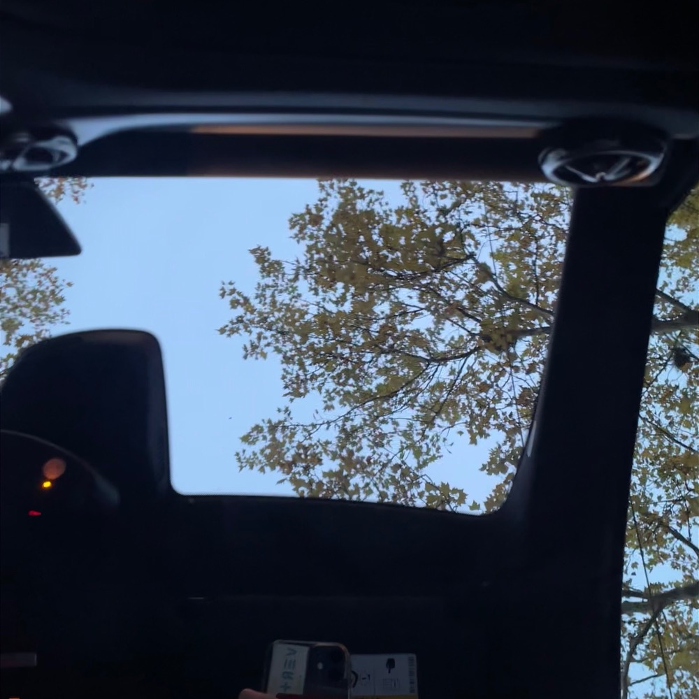

Yesterday I helped a friend move in. After transporting furniture and mirrors by car, we ate Indian take-away. On the parquet floor of her new empty room, with only a night table lamp and an inflatable bed.

An empty room asks nothing of us. No object is waiting to be used, repaired or tidied.

An empty room knows nothing about us. No objects hold past feelings and memories, like the ugly mug we got from a friend’s holiday. None hold future options, like the second IKEA set of dishes we keep just “in case”.

An empty room is also impersonal and unfamiliar, and objects are what soften that. They travel with us through time and space and remind us of who we were in another place and time, and that can feel good.

For pleasure or practicality, we want some objects to follow us, to bridge the place where we used to live and the new one we are making our own.

Today, the room is probably already shaped by the objects of the past. But last night all the objects waited outside, and for one evening the present was the only thing in the room.
